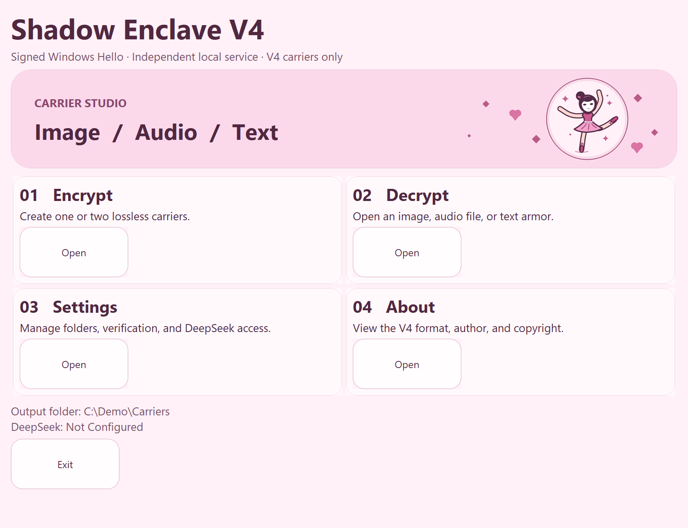
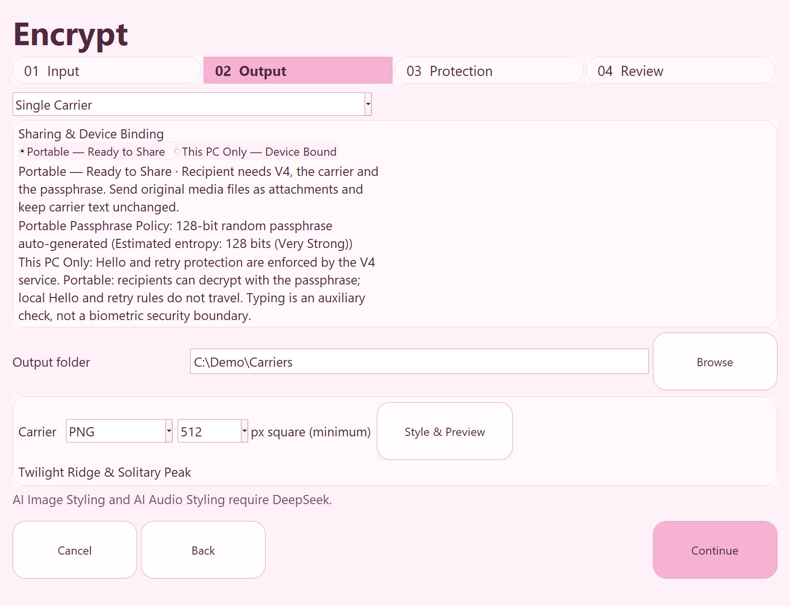
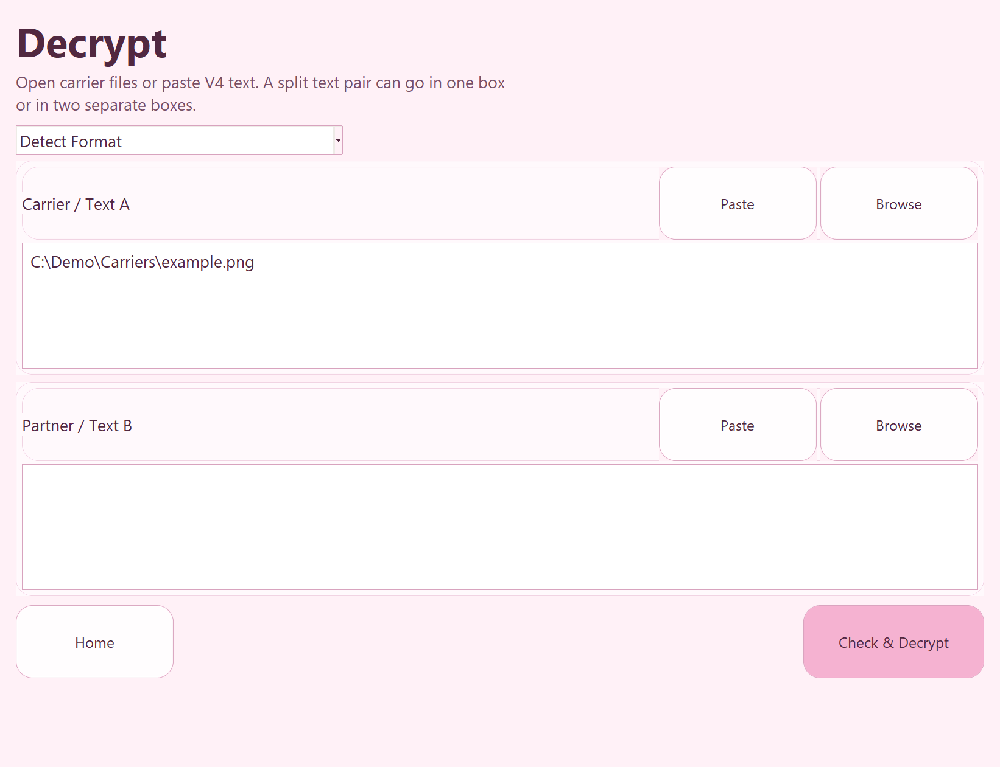

# Shadow Enclave V4

**English** · [简体中文](README.zh-CN.md) · [繁體中文](README.zh-TW.md)


Shadow Enclave V4 is an English-language Windows desktop app for encrypting text and carrying the ciphertext in images, audio, or text. Use **Portable** to send a message to another computer, or **This PC Only** to bind it to your Windows account and TPM. You can put the ciphertext in one carrier or split it across two matching parts.

[Quick start](#quick-start)



## Install on Windows

You need 64-bit Windows 11, an administrator who can approve service installation, and Windows Hello configured for the account using V4. **This PC Only** also requires a usable TPM 2.0. The prebuilt bundle includes the runtime, so recipients can use it without installing Python.

1. In the repository's **Releases** page, open **Assets** and download `ShadowEnclaveV4-Windows-x64.zip` and `ShadowEnclaveV4-Windows-x64.sha256`. If there is no installer asset yet, follow [Build from source](#build-from-source).
2. Compare the SHA-256 shown by the following commands before extracting the ZIP. The installer also checks the inner package against its bundled checksum. The download is unsigned. A checksum checks file integrity, and its value depends on where you obtained it.

   ```powershell
   Get-FileHash .\ShadowEnclaveV4-Windows-x64.zip -Algorithm SHA256
   Get-Content .\ShadowEnclaveV4-Windows-x64.sha256
   ```

3. Extract the **whole** bundle to a folder. Run `Install V4.cmd` and approve the Windows administrator prompt. This installs the app and its broker service.
4. Run `Start V4.cmd`. On first launch, choose **Enroll Windows Hello** and complete the native Windows prompts using the intended account. Windows handles the fingerprint, face, or PIN according to the device's policy.

## Quick start

### Create a test PNG

1. On the home screen, select **Open** under **Encrypt**. In **Input**, type `Hello from Shadow Enclave V4.` and select **Continue**.
2. In **Output**, select **Single Carrier**, **Portable — Ready to Share**, and **PNG**. Use **Browse** next to **Output folder** to choose where to save the file.
3. In **Protection**, securely save the generated passphrase. Select **Continue**, then select **Encrypt** in **Review**. Note the location of the exported PNG.



### Open the test PNG

1. Return to the home screen and select **Open** under **Decrypt**. Keep **Detect Format** selected. Select **Browse** next to **Carrier / Text A** and choose the exported PNG. Leave **Partner / Text B** empty for this test.
2. Select **Check & Decrypt**, enter the same passphrase, and complete Windows Hello. Verify that **Decryption Complete** shows the original message.



## Sharing and device binding

Send Portable carriers as original attachments and share the passphrase through a separate channel. For a split carrier, load both files from the same export into **Carrier / Text A** and **Partner / Text B**. Keep encoded text unchanged and avoid image or audio conversion.

| Mode | Where it opens | What is required |
| --- | --- | --- |
| **Portable** | Another computer can decrypt it | V4-compatible decryption, the passphrase, and every original carrier part. The official app uses the recipient's own local Hello enrollment. |
| **This PC Only** | The originating Windows account on the original PC | The passphrase, every carrier part, the protected service state, a valid V4 Hello enrollment, and the original TPM key. |

V4 opens V4 carriers. Use the corresponding older program for V1–V3 files.

## DeepSeek and privacy

Standard encryption, decryption, and local image/audio rendering work offline. To use **Camouflage Text**, **AI Cover Document**, **AI Image Styling**, or **AI Audio Styling**, add your own DeepSeek API key in **Settings**. AI features send generation prompts and any style instructions you enter to DeepSeek. Carrier plaintext and passphrases stay local, and image/audio rendering runs on your PC. Decrypting an already generated camouflage carrier requires the original text but no DeepSeek request. The Windows service protects the saved API key with DPAPI. Removing the saved key requires confirmation and Windows Hello.

Open **Settings**, enter your key, and select **Save with Windows Hello**. For a device-bound carrier, you can enable the optional typing check in **Protection**. Practice with a disposable message before relying on it.

## Security and recovery

- V4 derives a key with Argon2id (512 MiB, three passes) and encrypts with AES-256-GCM. Device-bound mode also needs a TPM-protected secret. Carrier appearance provides concealment with limits, and should be treated separately from encryption.
- The app uses Windows Hello at launch and asks for fresh verification when decrypting or changing saved settings. The broker applies a minimum one-second delay per decryption attempt and a 30-second cooldown after three failures per Windows account. Optional typing rhythm and alternate documents are local features. A modified client can synthesize typing intervals.
- Copies of Portable files can be attacked offline. The sender's Windows Hello, typing check, retry limits, and alternate documents do not travel with them. Use a strong passphrase.
- **Unenroll Windows Hello** revokes V4 sessions and keeps the service state and TPM key. Decryption requires successful reenrollment. Clearing the TPM, deleting service data, reinstalling Windows, or resetting Hello can leave **This PC Only** files unrecoverable. Keep a Portable copy if you need independent recovery.
- The intended security boundary is an ordinary Windows user process. Administrators, a compromised OS, and malware that reads authorized plaintext fall outside that boundary. V4 has not been independently audited.

## Updating and troubleshooting

- **Update:** Close V4 and run `Install V4.cmd` from the new extracted bundle. Repair uses the existing protected data location and preserves enrollment. The default data folder is `%ProgramData%\ShadowEnclave\V4`.
- **Hello or TPM unavailable:** Set up Windows Hello in Windows first. For device binding, check that TPM 2.0 is available and that Windows allows the required Hello policy. For transfers, select **Portable**.
- **Carrier rejected:** Use original attachments and verify both parts came from the same export. Check that the carrier is V4 and that you have the correct passphrase.
- **DeepSeek request failed:** Check your API key, network access, API balance, and service availability. You can still use the standard offline carriers.

For a custom verification-data location, run `& '.\Install V4.cmd' -DataDirectory 'D:\ShadowEnclaveV4Data'` in PowerShell on first installation. Choose an empty folder on a local drive with no symbolic links or junctions in the path. Repair reuses this location.

## Build from source

To download the source with Git, copy the HTTPS address from **Code** on GitHub and use it in place of `<repository-https-url>`.

```powershell
git clone "<repository-https-url>" ShadowEnclaveV4
cd ShadowEnclaveV4
```

On 64-bit Windows, install standard CPython 3.14 with Tcl/Tk and make sure the Windows .NET Framework 4.x compiler is available. From the repository root in PowerShell:

```powershell
python -m venv .venv
.\.venv\Scripts\python.exe -m pip --isolated install --only-binary=:all: --index-url https://pypi.org/simple -r requirements-build.txt
.\.venv\Scripts\python.exe -m unittest -q test_v4
powershell.exe -NoProfile -ExecutionPolicy Bypass -File .\Build-V4.ps1 -Python .\.venv\Scripts\python.exe
```

The build creates `release/ShadowEnclaveV4-Windows-x64.zip` and its `.sha256` file. The unit tests use disposable data. Hardware-backed Hello and TPM tests require an interactive Windows machine.

For repository maintainers, run **Actions → Build Windows installer → Run workflow**. The workflow tests the code and builds on a GitHub-hosted Windows runner without access to your PC's service data or API key. Download and extract the workflow artifact, then attach the installer ZIP and `.sha256` file to a GitHub Release. The **Source code** archives on the Release page contain the repository files.

## Copyright

Copyright © 2026 Shadow Enclave Project. See [COPYRIGHT.txt](COPYRIGHT.txt). Third-party notices are included under `licenses/` in the install payload.
