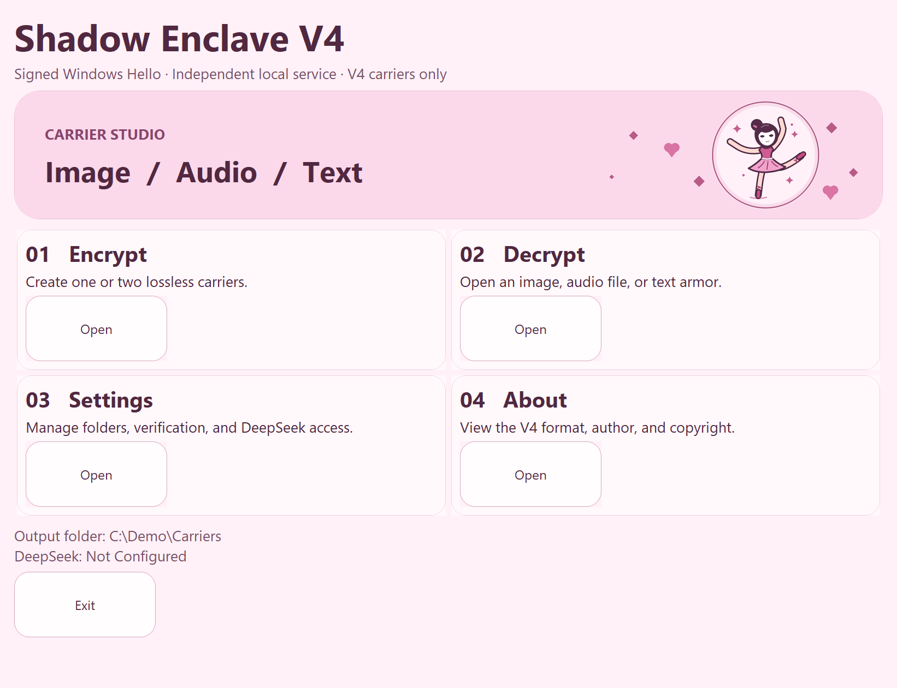
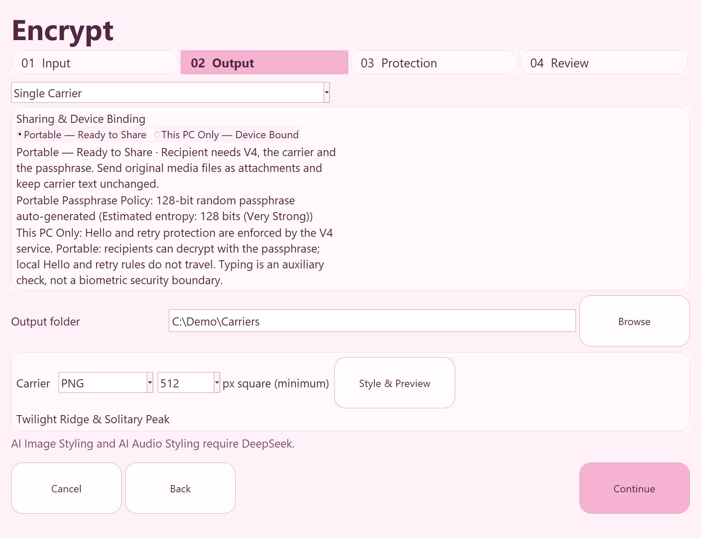
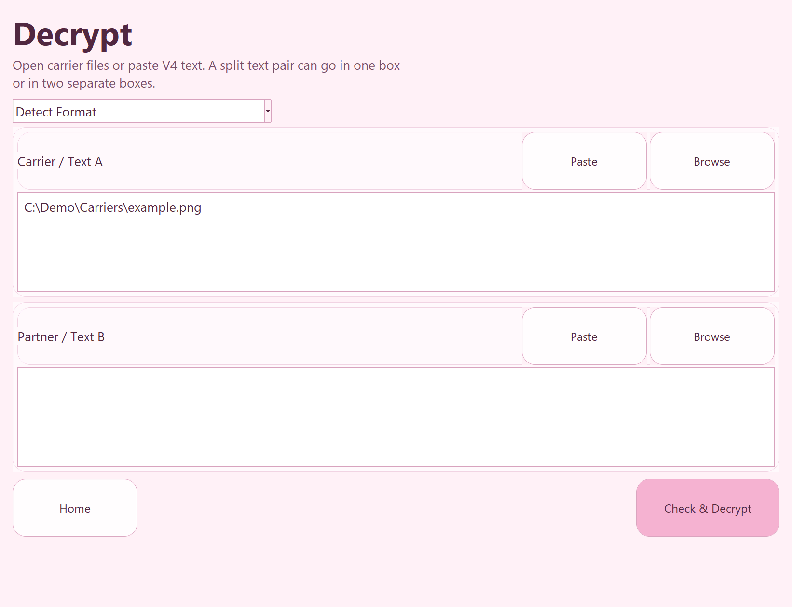

# Shadow Enclave V4

[English](README.md) · **简体中文** · [繁體中文](README.zh-TW.md)


Shadow Enclave V4 是一款英文界面的 Windows 桌面应用，可加密文本，并将密文嵌入图片、音频或文本载体。选择 **Portable** 可发送到其他电脑，选择 **This PC Only** 则绑定当前 Windows 账户和 TPM。你可以生成单个载体，也可以将密文拆成两份配套载体。

[快速开始](#快速开始)



## 在 Windows 上安装

你需要 64 位 Windows 11、可以批准安装服务的管理员，以及已为使用 V4 的账户设置好的 Windows Hello。**This PC Only** 还需要可用的 TPM 2.0。预编译安装包已经包含运行环境，接收者无需安装 Python。

1. 在仓库的 **Releases** 页面打开 **Assets**，下载 `ShadowEnclaveV4-Windows-x64.zip` 和 `ShadowEnclaveV4-Windows-x64.sha256`。如果还没有安装包，可以[从源码构建](#从源码构建)。
2. 解压前，用下列命令对比 SHA-256。安装程序还会检查内层安装包的校验值。安装包未签名，校验值可以检查文件完整性，其可信度取决于获取来源。

   ```powershell
   Get-FileHash .\ShadowEnclaveV4-Windows-x64.zip -Algorithm SHA256
   Get-Content .\ShadowEnclaveV4-Windows-x64.sha256
   ```

3. 将**完整**安装包解压到一个文件夹，运行 `Install V4.cmd`，批准 Windows 管理员提示。脚本会安装桌面应用及其后台服务。
4. 运行 `Start V4.cmd`。首次启动时，选择 **Enroll Windows Hello**，使用预定的 Windows 账户完成系统提示。指纹、人脸或 PIN 由 Windows 根据设备策略处理。

## 快速开始

### 生成测试 PNG

1. 在主界面的 **Encrypt** 卡片中点击 **Open**。在 **Input** 输入 `Hello from Shadow Enclave V4.`，点击 **Continue**。
2. 在 **Output** 选择 **Single Carrier**、**Portable — Ready to Share** 和 **PNG**。点击 **Output folder** 旁的 **Browse** 选择保存位置。
3. 在 **Protection** 妥善保存自动生成的口令。点击 **Continue**，再在 **Review** 中点击 **Encrypt**。记下导出的 PNG 所在位置。



### 打开测试 PNG

1. 返回主界面，在 **Decrypt** 卡片中点击 **Open**。保留 **Detect Format**。点击 **Carrier / Text A** 旁的 **Browse** 选择刚导出的 PNG。这次测试将 **Partner / Text B** 留空。
2. 点击 **Check & Decrypt**，输入同一口令并完成 Windows Hello 验证。确认 **Decryption Complete** 显示原始消息。



## 共享与设备绑定

请将 Portable 载体作为原始附件发送，通过另一个渠道分享口令。双载体请选择同一次导出的两份文件，分别填入 **Carrier / Text A** 和 **Partner / Text B**。保持编码文本原样，并避免转换图片或音频。

| 模式 | 可解密的位置 | 所需条件 |
| --- | --- | --- |
| **Portable** | 可在另一台电脑上解密 | 支持 V4 的解密程序、口令和全部原始载体。使用官方应用时，接收者用自己的 Windows Hello 注册。 |
| **This PC Only** | 原电脑上的原 Windows 账户 | 口令、全部载体、受保护的服务数据、有效的 V4 Hello 注册和原 TPM 密钥。 |

V4 支持 V4 载体。V1–V3 文件请用相应的旧版程序打开。

## DeepSeek 与隐私

标准加密、解密和本地图片、音频渲染都可以离线使用。使用 **Camouflage Text**、**AI Cover Document**、**AI Image Styling** 或 **AI Audio Styling** 时，需要在 **Settings** 中填写你自己的 DeepSeek API 密钥。AI 功能会向 DeepSeek 发送生成提示词，以及你主动填写的风格说明。载体明文和口令留在本机，图片与音频也在本机渲染。解密已经生成的伪装文本只需要原始载体文本，无需请求 DeepSeek。保存的密钥由 Windows 服务通过 DPAPI 保护。移除密钥需要确认并通过 Windows Hello 验证。

打开 **Settings**，输入密钥，再点击 **Save with Windows Hello**。 对于绑定本机的载体，可以在 **Protection** 启用可选的打字检查。请先用测试消息练习。

## 安全性与恢复

- V4 使用 Argon2id（512 MiB、3 轮）派生密钥，使用 AES-256-GCM 加密。本机绑定还需要 TPM 保护的秘密。载体外观可以掩饰密文，但掩饰能力有限，应与加密强度分开看待。
- 启动需要 Windows Hello。每次解密和更改已保存的设置都需要重新验证。后台服务为每次解密尝试设置至少 1 秒延迟，同一 Windows 账户失败 3 次后冷却 30 秒。可选的打字节奏和替代文档属于本机功能。修改过的客户端可以模拟按键间隔。
- **Portable** 文件的副本可以被离线尝试破解。发送者的 Windows Hello、打字检查、重试限制和替代文档不会随文件传输。请使用高强度口令。
- **Unenroll Windows Hello** 会撤销 V4 会话，并保留服务数据和 TPM 密钥。重新注册成功后才能解密。清除 TPM、删除服务数据、重装 Windows 或重置 Hello 可能使 **This PC Only** 文件无法恢复。需要独立恢复时，请保留一份 **Portable** 副本。
- 设计防护范围是普通 Windows 用户进程。管理员权限、已被攻陷的操作系统、以及在授权后读取明文的恶意软件都超出这一范围。V4 尚未经过独立安全审计。

## 更新与故障排查

- **更新程序**。关闭 V4，然后在新解压的安装包中运行 `Install V4.cmd`。修复安装会使用原有的受保护数据目录并保留注册。默认目录为 `%ProgramData%\ShadowEnclave\V4`。
- **Hello 或 TPM 不可用**。先在 Windows 中设置 Hello。如需绑定本机，确认 TPM 2.0 可用且 Windows 允许程序所需的 Hello 策略。传输文件时选择 **Portable**。
- **无法读取载体**。使用原始附件，确认两份载体来自同一次导出，并核对 V4 格式和口令。
- **DeepSeek 请求失败**。检查密钥、网络、API 余额和服务状态。标准离线载体仍可使用。

如果需要自定义验证数据的位置，首次安装时可在 PowerShell 中运行 `& '.\Install V4.cmd' -DataDirectory 'D:\ShadowEnclaveV4Data'`。请选择本地磁盘上的空文件夹，路径中应没有符号链接或目录联接。修复安装会继续使用这个位置。

## 从源码构建

要用 Git 下载源码，请在 GitHub 的 **Code** 菜单复制 HTTPS 地址，并替换 `<repository-https-url>`。

```powershell
git clone "<repository-https-url>" ShadowEnclaveV4
cd ShadowEnclaveV4
```

在 64 位 Windows 上安装带 Tcl/Tk 的标准 CPython 3.14，并确认系统具有 .NET Framework 4.x 编译器。在仓库根目录打开 PowerShell，运行以下命令。

```powershell
python -m venv .venv
.\.venv\Scripts\python.exe -m pip --isolated install --only-binary=:all: --index-url https://pypi.org/simple -r requirements-build.txt
.\.venv\Scripts\python.exe -m unittest -q test_v4
powershell.exe -NoProfile -ExecutionPolicy Bypass -File .\Build-V4.ps1 -Python .\.venv\Scripts\python.exe
```

生成的文件为 `release/ShadowEnclaveV4-Windows-x64.zip` 和配套的 `.sha256`。单元测试使用临时测试数据。硬件 Hello 和 TPM 测试需要可以交互操作的 Windows 电脑。

维护者可以运行 **Actions → Build Windows installer → Run workflow**。工作流会在 GitHub 托管的 Windows 环境中测试和构建，不需要访问你电脑上的服务数据或密钥。下载并解压工作流产物，再将安装 ZIP 和 `.sha256` 附加到 GitHub Release。Release 页面上的 **Source code** 压缩包包含仓库源码。

## 版权

Copyright © 2026 Shadow Enclave Project。参见 [COPYRIGHT.txt](COPYRIGHT.txt)。安装包内的 `licenses/` 包含第三方许可声明。
